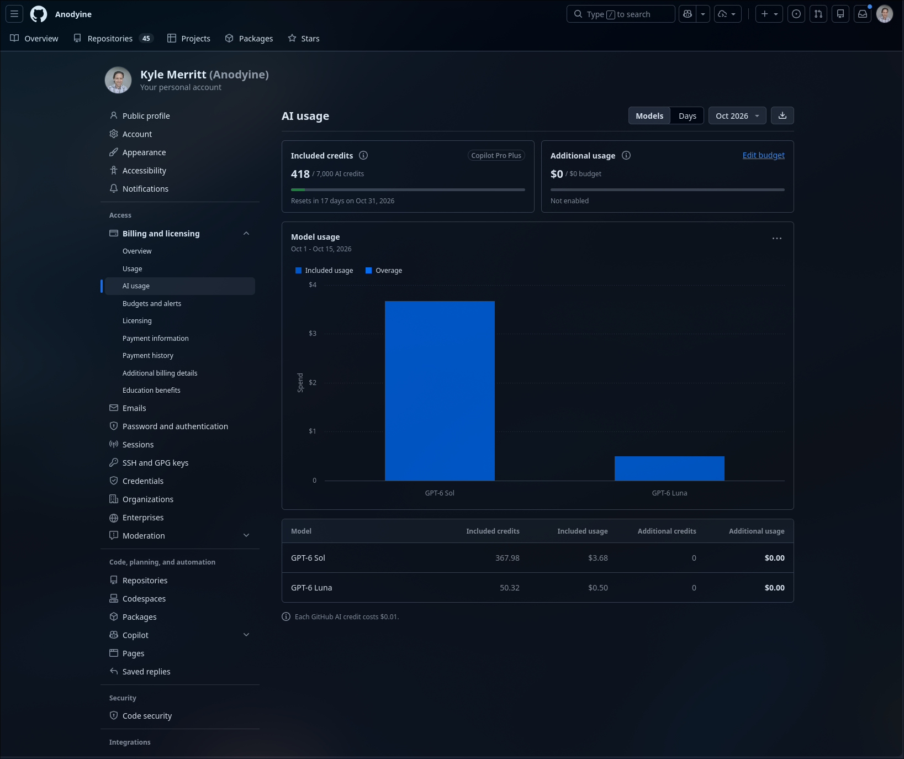

## Executive summary

### Research Questions

1. Which combinations of model and coding agent finish useful work across information gathering, well-defined code updates, and architecture tasks?
2. How do completeness, quality, critical errors, time, intervention, and measured usage differ by task type?
3. Which model and coding-agent combination is the best operational fit for our team across these three kinds of work?
4. Which observed differences are large enough to inform an operating choice, and which need more tasks or human review?

### Brief approach

We evaluated three kinds of work: **information gathering (IG)**, where an agent researches and synthesizes evidence; **defined repository updates (DU)**, where it changes code against a known failing check; and **architectural planning or refactoring (AR)**, where it proposes a design or makes a broader code change. We selected five tasks in each category, for 15 tasks total. We compared Pi with GPT-6 Luna, Pi with GPT-6 Sol, OpenCode with GPT-6 Luna, and Claude Code with Claude Opus 5.5. Each pair attempted all 15 tasks, for **60 attempts**. Every pair received the same prompt and starting repository revision for a given task, with a fresh session and a 15-minute limit. We saved answers and code changes, and a separate GPT-6 Sol judge assessed each attempt in a fresh context without seeing which pair produced it. For code tasks, we ran prepared checks on the saved changes in temporary repository checkouts. We compared the judge's 1–5 quality score, completion, number of critical errors, and retrospective need for clarification; elapsed time to the final deliverable; code-check results; and the account-level Sol/Luna Copilot credit difference. Each result reflects one initial attempt; we did not measure how a pair would improve after follow-up prompts. The later sections explain the scoring, task choices, and limits.

### Conclusions and overall results

Across the 15 tasks, no pair led on every measure:

- **Most consistent completion: Claude Code + Opus.** It completed 14/15 tasks, the most of any pair, and finished at least four of five in every task category. Pi + Luna was close at 13/15, with Good, Good, and Excellent category ratings. These two pairs have the strongest completion records in this sample.
- **Highest judged quality: Pi + Sol.** It received 5/5 on 11 of 15 tasks, the most of any pair, and its mean quality was 4.60/5. Pi + Luna followed with nine 5s and a 4.47 mean. Sol completed 12/15 tasks, so its quality lead did not also give it the completion lead. Both Pi pairs had two critical-error judgments that still need human review.
- **Fastest overall: Pi + Sol.** Its median final deliverable time was 44.3 seconds, the lowest of the four pairs. It finished faster than Pi + Luna on all 15 matched tasks and faster than Claude Code + Opus on 14/15.
- **Aggregate Copilot credit signal: Sol consumed more.** A user-supplied GitHub AI usage screenshot for 1–15 October shows 367.98 credits for GPT-6 Sol and 50.32 for GPT-6 Luna, a 7.31× model-level difference. The account holder reports using this Copilot account only for the evaluations. If Luna was used twice as often as Sol, as in the scored attempts, Sol's usage-normalized credit intensity was about **14.6×** Luna's. That ratio is a rough estimate across tests and probes, not measured credits for any pair's individual attempts.
- **Recommended mixed-workload exclusion: OpenCode + Luna.** It completed 8/15 tasks, including only 1/5 information-gathering and 2/5 defined-update tasks, and received Unacceptable ratings in both categories. It also had the lowest mean quality (3.93/5) and only two 5/5 scores. Its 5/5 AR completion and Good AR rating make it a plausible candidate for architecture work specifically, pending review.
- **Best provisional balance: Pi + Luna.** It completed 13/15 tasks, earned Good, Good, and Excellent category ratings, and received nine 5/5 judgments. It trailed Claude Code + Opus by one completed task and Pi + Sol in speed and mean judged quality. Luna's published Copilot token rates and the account-level usage snapshot point to substantially lower credit use than Sol, although Pi-specific credits per task were not measured. The final operating choice awaits blind human review and cost reconciliation.

These results apply to each **model plus coding agent**, not to a model in isolation. Different search tools and configurations may explain some differences. Five tasks per category and one attempt per pair and task make this an exploratory comparison.

| Model + coding agent | IG: complete; rating | DU: complete; rating | AR: complete; rating | All complete | 5/5 scores | Mean quality / 5 | Median final time | Critical errors |
|---|---|---|---|---:|---:|---:|---:|---:|
| GPT-6 Luna + Pi | 4/5; Good | 4/5; Good | 5/5; Excellent | 13/15 | 9/15 | 4.47 | 75.7 s | 2 |
| GPT-6 Sol + Pi | 3/5; Practical | 4/5; Good | 5/5; Excellent | 12/15 | 11/15 | 4.60 | 44.3 s | 2 |
| GPT-6 Luna + OpenCode | 1/5; Unacceptable | 2/5; Unacceptable | 5/5; Good | 8/15 | 2/15 | 3.93 | 72.4 s | 2 |
| Claude Opus 5.5 + Claude Code | 5/5; Good | 4/5; Good | 5/5; Good | 14/15 | 5/15 | 4.20 | 102.7 s | 1 |

IG, DU, and AR are the task categories defined above. “Complete” means the judge found the requested deliverable complete; all 60 agent processes finished, but some produced only partial work. “Critical error” means the judge identified a consequential mistake; those calls still need human review. Mean quality summarizes 15 scores on a 1–5 scale and is not a calibrated estimate of general ability. The [rating rules](../config/rubric.yaml) assign Excellent, Good, or Practical from a category's median quality, completion rate, and critical-error count; Unacceptable means the category fell below the Practical threshold. Each rating summarizes five tasks; no pooled 15-task rating was assigned.

| Task type | Pair | Tasks complete | Quality distribution, scores 1/2/3/4/5 | Median final time | Critical errors | Validated green |
|---|---|---:|---|---:|---:|---:|
| IG | Luna + Pi | 4/5 | 0/0/1/1/3 | 65.0 s | 1 | n/a |
| IG | Sol + Pi | 3/5 | 0/0/1/1/3 | 33.8 s | 1 | n/a |
| IG | Luna + OpenCode | 1/5 | 0/1/0/3/1 | 28.9 s | 1 | n/a |
| IG | Opus + Claude Code | 5/5 | 0/0/0/4/1 | 103.7 s | 0 | n/a |
| DU | Luna + Pi | 4/5 | 0/0/1/2/2 | 63.6 s | 1 | 5/5 |
| DU | Sol + Pi | 4/5 | 0/0/1/0/4 | 40.9 s | 1 | 5/5 |
| DU | Luna + OpenCode | 2/5 | 0/0/1/4/0 | 57.7 s | 1 | 5/5 |
| DU | Opus + Claude Code | 4/5 | 0/1/0/1/3 | 43.8 s | 1 | 4/5 |
| AR | Luna + Pi | 5/5 | 0/0/0/1/4 | 178.9 s | 0 | 1/1 code task |
| AR | Sol + Pi | 5/5 | 0/0/0/1/4 | 103.7 s | 0 | 1/1 code task |
| AR | Luna + OpenCode | 5/5 | 0/0/0/4/1 | 165.0 s | 0 | 1/1 code task |
| AR | Opus + Claude Code | 5/5 | 0/0/0/4/1 | 254.6 s | 0 | 1/1 code task |

The quality distribution lists counts for scores 1, 2, 3, 4, and 5 in that order; for example, `0/0/1/1/3` means one 3, one 4, and three 5s. “Median final time” measures time to the completed deliverable, not time to the first visible output. “Validated green” counts attempts that passed the prepared code checks. Passing a check does not by itself prove the requested behavior is complete, as DU-04 illustrates below. `n/a` means no code validation applied. None of the agents asked a clarifying question, although the automated judge retrospectively marked six answers as needing one (two IG, four DU). That classification measures a judged gap, not an actual delay or human intervention during the runs.

## Detailed results supporting the summary

In all three task tables, the number is the judge's quality score out of 5. `C` means the judge found the requested deliverable complete; it counts toward the **tasks complete** totals. `P` means partial: the pair attempted the task and its quality score is included in the score summaries, but the task does not count as complete. For example, `4/P` is a 4/5 answer with an incomplete deliverable. Code tasks also show `V` or `F` for passed or failed validation; validation and judged completion are separate measures.

### IG: information gathering

Four pairs attempted each of the five research tasks. The full [information-gathering run report](../results/local-repos-20261015-122649/report.md) links every answer and judgment.

| Task | Luna + Pi | Sol + Pi | Luna + OpenCode | Opus + Claude Code |
|---|---:|---:|---:|---:|
| IG-01 — reconcile model benchmark scores from multiple sources | 3/P | 3/P | 2/P | 4/C |
| IG-02 — investigate whether a retried pull-request merge can duplicate an action | 5/C | 5/C | 4/P | 4/C |
| IG-03 — compare two repositories' runtime requirements | 5/C | 5/C | 4/P | 4/C |
| IG-04 — check Playwright feature support against the installed version | 4/C | 4/P | 5/C | 4/C |
| IG-05 — decide whether qualification results justify ranking agent setups | 5/C | 5/C | 4/P | 5/C |

IG-01 produced the clearest shared difficulty: three pairs were partial and each received one critical-error judgment. Those judgments have not yet had blind human review. The Sol + Pi score on IG-04 was 4/5 but its deliverable was judged partial, illustrating why score and completion are shown separately.

### DU: defined repository updates

Each cell gives **quality score / completion / validation**. `V` means the prepared focused and regression checks passed; `F` means validation failed. Validation alone did not establish complete behavior: all three non-Opus DU-04 attempts passed the prepared checks yet were judged partial with a critical error. The [adjudicated DU report](../results/du-2026-10-15-adjudicated/report.md) links answers, patches, checks, and judgments.

| Task | Luna + Pi | Sol + Pi | Luna + OpenCode | Opus + Claude Code |
|---|---:|---:|---:|---:|
| DU-01 — delete todo API | 5/C/V | 5/C/V | 4/P/V | 5/C/V |
| DU-02 — filter todo list | 5/C/V | 5/C/V | 4/C/V | 5/C/V |
| DU-03 — reject duplicate repository assignments | 4/C/V | 5/C/V | 4/C/V | 4/C/V |
| DU-04 — include a symbolic link's target in the workspace integrity hash | 3/P/V | 3/P/V | 3/P/V | 2/P/F |
| DU-05 — reject malformed repository metadata | 4/C/V | 5/C/V | 4/P/V | 5/C/V |

DU-04 was incomplete for every pair and received all four DU critical-error judgments. The original prepared checks passed for all four; the `F` for Claude Code + Opus includes an additional collision check applied during adjudication. The same new check should be applied to every pair in any future run. The original DU run and the review of saved work are separate; the adjudicated table above is the comparison basis. Blind human review of the critical-error judgments remains pending.

### AR: architectural planning and refactoring

All four pairs completed all five architecture tasks, with zero critical-error judgments. Four tasks requested implementation plans; only AR-05 requested a code refactor. `V` on AR-05 means the evaluation runner's test suite passed in a fresh checkout. The full [AR report](../results/ar-2026-10-15-full/report.md) links each answer, patch, and judgment.

| Task | Deliverable | Luna + Pi | Sol + Pi | Luna + OpenCode | Opus + Claude Code |
|---|---|---:|---:|---:|---:|
| AR-01 — consolidate pull-request effect coordination | Plan | 5/C | 5/C | 4/C | 5/C |
| AR-02 — recover a research helper process safely | Plan | 5/C | 5/C | 5/C | 4/C |
| AR-03 — recover an interrupted benchmark scheduler | Plan | 5/C | 4/C | 4/C | 4/C |
| AR-04 — preserve desktop/backend runs through a restart | Plan | 5/C | 5/C | 4/C | 4/C |
| AR-05 — separate runner workspace and conversation handling | Code | 4/C/V | 5/C/V | 4/C/V | 4/C/V |

Pi + Sol and Pi + Luna had the same score distribution (four 5s and one 4). Sol's median final time was 103.7 seconds versus Luna's 178.9 seconds, and it finished faster on each of the five matched AR tasks. Their 4s came on different tasks. The judge found an unresolved migration step in Sol's AR-03 recovery plan; Luna's AR-05 code change lacked direct tests of cleanup and failure behavior. OpenCode + Luna completed all five tasks, in contrast with its lower completion rate in IG and DU. Claude Code + Opus also completed all five, but had the longest median final time at 254.6 seconds.

All four AR-05 patches passed the configured runner suite in a fresh checkout: 18 tests for Pi + Luna, 18 for Pi + Sol, 17 for OpenCode + Luna, and 20 for Claude Code + Opus. Counts differ because agents added different tests. The four planning tasks had no automated pass/fail validation; their scores are judgments of the proposed plans, not proof that the plans will work when implemented. Blind human review of selected plans and AR-05 code changes is still pending.

**Architecture-task time to final deliverable, seconds** (rounded from the runner's measurements):

| Task | Luna + Pi | Sol + Pi | Luna + OpenCode | Opus + Claude Code |
|---|---:|---:|---:|---:|
| AR-01 | 122 | 104 | 84 | 255 |
| AR-02 | 209 | 67 | 94 | 234 |
| AR-03 | 454 | 239 | 217 | 535 |
| AR-04 | 164 | 164 | 165 | 279 |
| AR-05 | 179 | 97 | 171 | 103 |

Sol + Pi was faster than Luna + Pi on AR-04 by about 0.05 seconds; rounding both to 164 seconds conceals that small difference. The full CSV retains the unrounded values. We use final-deliverable time for comparisons because the tools report initial output differently.

### Cross-pair interpretation and remaining measurements

Across all 15 prompts, Pi + Luna completed 13 versus OpenCode + Luna's 8 with the same named model. Pi + Sol completed 12 versus Pi + Luna's 13; Sol was faster on all 15 matched prompts and had three quality wins, eleven ties, and one loss. Claude Code + Opus completed 14, one more than Pi + Luna and two more than Pi + Sol. Its greater completion rate did not come with a lead in mean judge quality or final time. These comparisons cannot isolate model quality from the coding-agent program, its tools, or its provider. Close comparisons may change after blind human review.

In the table below, a quality win means the first pair received a higher judge score on the **same task**; “faster” counts tasks where it finished sooner, out of five in each category.

| First pair versus second | Task category | Quality wins / ties / losses for first pair | First pair faster |
|---|---|---:|---:|
| Sol + Pi vs Luna + Pi | IG | 0 / 5 / 0 | 5/5 |
| Sol + Pi vs Luna + Pi | DU | 2 / 3 / 0 | 5/5 |
| Sol + Pi vs Luna + Pi | AR | 1 / 3 / 1 | 5/5 |
| Sol + Pi vs Opus + Claude Code | IG | 2 / 2 / 1 | 5/5 |
| Sol + Pi vs Opus + Claude Code | DU | 2 / 3 / 0 | 4/5 |
| Sol + Pi vs Opus + Claude Code | AR | 3 / 2 / 0 | 5/5 |
| Luna + Pi vs Luna + OpenCode | IG | 4 / 0 / 1 | 0/5 |
| Luna + Pi vs Luna + OpenCode | DU | 2 / 3 / 0 | 2/5 |
| Luna + Pi vs Luna + OpenCode | AR | 3 / 2 / 0 | 1/5 |

**Account-level Copilot usage, 1–15 October 2026.** The account holder supplied a [GitHub AI usage snapshot](../results/copilot-ai-usage-2026-10-15/README.md) and confirmed that this Copilot account was used only for these evaluations in the period. The screenshot is from a personal Copilot Pro+ account with 7,000 included credits; the team's expected allowance is about 1,900 credits per person per month. The page showed:

| Model | Included AI credits | Displayed included usage |
|---|---:|---:|
| GPT-6 Sol | 367.98 | $3.68 |
| GPT-6 Luna | 50.32 | $0.50 |

*Figure: Account-level Copilot AI usage for 1–15 October 2026. The screenshot does not attribute credits to individual evaluation attempts.*

Sol accounted for about 88% of the 418.30 model-attributed credits shown; its aggregate was 7.31 times Luna's. This includes evaluation activity beyond the scored attempts, such as live probes and any pilots or reruns. The scored comparison itself contains 15 Sol + Pi attempts and 30 Luna attempts split between Pi and OpenCode. Assuming the same two-to-one Luna-to-Sol **number of uses** held across all account activity, the estimated credit comparison per use is `(367.98 / 1) / (50.32 / 2) = 14.63`, or about **14.6× more Sol credits per assumed use**. This is an estimate: the mix of probes, pilots, and reruns is unknown. The screenshot groups by model, so it cannot allocate Luna credits between Pi and OpenCode or assign credits to individual tasks. It establishes a strong **directional, model-level** consumption difference for this account; neither ratio is a measured per-task price ratio. The original screenshot and a machine-readable transcription are preserved with the results.

GitHub's [Copilot models and pricing](https://docs.github.com/en/copilot/reference/copilot-billing/models-and-pricing) explains that an interaction's credit use depends on **both the model and the number of input, output, and cached tokens**. One AI credit corresponds to $0.01. Its default-tier rates for these models, in US dollars per million tokens, are:

| Model | Input | Cached input | Cache write | Output |
|---|---:|---:|---:|---:|
| GPT-6 Luna | $0.10 | $0.01 | $0.125 | $0.50 |
| GPT-6 Sol | $2.00 | $0.20 | $2.50 | $10.00 |

GitHub also lists a long-context tier above 272K input tokens. In both tiers, Sol's published rate is **20× Luna's** for each corresponding token type. OpenAI's API pages for [GPT-6 Sol](https://developers.openai.com/api/docs/models/gpt-6-sol) and [GPT-6 Luna](https://developers.openai.com/api/docs/models/gpt-6-luna) show the same default-tier ratio. These rates corroborate the direction of the account-level credit difference, not the exact 14.6× usage-normalized estimate: token counts and tool behavior can differ by model and coding-agent program, and the screenshot does not isolate the scored attempts.

| Evidence still needed for a final decision | Current status |
|---|---|
| Blind human review of critical errors and disputed judgments | Pending |
| Copilot credits attributable to individual runs | Unavailable; the account-level model comparison appears above |
| Comparable monetary cost across Copilot and Anthropic billing | Pending; native usage units differ |
| Graphical interface usability | Outside this evaluation; assess separately |

## Methodology and interpretation notes

### Task and run design

The [task-design criteria](repo-task-design.md) guided the selection. The exact prompts are in the [research](../config/tasks.yaml), [defined-update](../config/defined-updates.yaml), and [architecture](../config/architecture.yaml) task files. Before each run, we fixed the prompt, repository revision, tool access, and 15-minute limit. Each pair received those same conditions for a given task. Research tasks used read-only copies of repository files. Code and architecture tasks used temporary Git checkouts at the selected revisions, leaving active developer checkouts untouched. For defined updates, a prepared check failed before the code change; we then applied each saved patch to a clean checkout and reran the prepared and regression checks. The same standardized reply was available if an agent asked a clarifying question. None did in these 60 attempts; the judge's retrospective assessment of whether clarification would have helped is a separate judgment. The evaluation runner recorded status, timing, artifacts, tool activity, and available usage.

### Evaluated pairs and exclusions

The evaluated pairs were Pi with GPT-6 Luna, Pi with GPT-6 Sol, OpenCode with GPT-6 Luna, and Claude Code with Claude Opus 5.5. All used their configured medium reasoning setting. Pi and OpenCode accessed the OpenAI models through GitHub Copilot; Claude Code used a separate Anthropic account.

The goal was **one setup capable of all three task types**. We excluded the standalone GitHub Copilot CLI because its noninteractive web-search probe could not search the web, which the research tasks require. That decision does not measure Copilot CLI's ability on code updates or architecture work. We also excluded Google's Antigravity CLI: an earlier run had command-permission problems, and a follow-up that allowed commands hit the account's usage quota. Those are access and execution limits, not comparative quality results. Neither excluded setup contributed to the four-pair scores above.

### Web search and page fetch by pair

The evaluated setups reached online information through different providers and page-reading tools. All could search and fetch pages in a preliminary probe, but that does not mean they received the same results, page content, response time, or source coverage.

| Pair | Web search route | Web fetch route |
|---|---|---|
| GPT-6 Luna + Pi | Installed `pi-web-search` extension sends `web_search` through the configured GitHub Copilot model endpoint. | Installed `pi-web-fetch` extension renders and extracts pages locally and can use the configured Copilot model to process the content. |
| GPT-6 Sol + Pi | Same Pi extension and Copilot route, using the Sol model. | Same Pi fetch extension, using the Sol model when model processing is needed. |
| GPT-6 Luna + OpenCode | OpenCode's `websearch` uses the pinned `tinyfish` hosted search provider, set in a per-process `OPENCODE_CONFIG_CONTENT` configuration. | OpenCode's `webfetch` tool was explicitly allowed in that configuration. |
| Claude Opus 5.5 + Claude Code | Claude Code's built-in `WebSearch` tool was explicitly allowed. | Claude Code's built-in `WebFetch` tool was explicitly allowed. |

OpenCode ran with `--standalone` so its private process used the selected search configuration instead of an existing background service. Before each task-category run, the preliminary probe observed both a search and a page fetch for every included pair. This proves those tools were callable in the probe sessions; it does not establish comparable result quality or reliability on the actual tasks. The difference matters most for research tasks and limits how confidently the Pi-versus-OpenCode gap can be attributed to the coding agent tool alone. Configuration and probe records are in the [adapter](../src/agent_eval/adapters.py), [arm configuration](../config/arms.yaml), and the [IG](../results/local-repos-20261015-122649/manifest.json), [DU](../results/du-2026-10-15-adjudicated/manifest.json), and [AR](../results/ar-2026-10-15-full/manifest.json) manifests.

### Copilot credit attribution

The [account screenshot](../results/copilot-ai-usage-2026-10-15/source.png) is a billing view for 1–15 October, not an export linked to individual evaluation runs. GitHub's [billing report reference](https://docs.github.com/en/billing/reference/billing-reports) describes AI usage grouped by date, model, and username. The runner saved per-attempt token counts and tool-reported cost fields, but none of the 45 Copilot-backed scored attempts reported credits directly. We did not convert those cost fields into Copilot credits. Under the account holder's statement that the account was used only for evaluations, the screenshot supports a model-level comparison; it cannot separate Pi from OpenCode Luna use or allocate credits to individual tasks. Preliminary probes also used models and are absent from the 60 scored attempt rows.

### Agentic judge and evidence packs

We used GPT-6 Sol as a separate **automated judge** for each completed attempt. Each judgment started in a fresh Codex CLI process with a scoring rubric, the agent's answer and anonymized activity, and a task-specific reference pack. The judge did not receive the pair's identity, raw billing fields, or other agents' attempts. For code tasks, it also saw the saved patch and check results. The reference packs recorded source excerpts, facts tied to repository revisions, acceptable alternative answers, required checks, and mistakes that would change the decision; agents could not see those packs. The judge assigned a 1–5 quality score, marked the requested work complete or partial, flagged critical errors, and assessed whether a follow-up question would have been needed. These are automated judgments, distinct from measured time and command results. Blind human review has not yet been added.

### DU adjudication and comparability

The original defined-update run marked five attempts failed because agents edited the prepared tests. On review, their saved source changes passed the original tests when those tests were restored unchanged. The [adjudication record](../results/du-2026-10-15-adjudicated/ADJUDICATION.md) judged those saved attempts without rerunning agents. A further test found that the Claude Code change for DU-04 could miss a symbolic-link change, leading to a revised judgment. The original run remains as an audit trail; this report uses the adjudicated results. Any future run of DU-04 should apply the revised check to every pair.

### Limits

This is an exploratory comparison of five tasks per category, with one attempt per pair and task. Four of the five architecture tasks asked for plans; these results say more about planning than about executing deep refactors. Ratings use a scoring rule fixed before the runs and are not statistically precise rankings. Scores are ordinal and depend on an automated judge; code checks can miss defects. Missing cost or timing fields mean unavailable, never zero. Initial-output times are also less comparable across tools than final-deliverable times because their event streams differ. A final recommendation should follow blind human review of consequential errors, representative architecture plans, and code changes.
